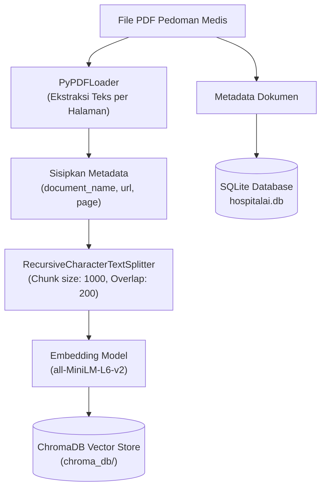
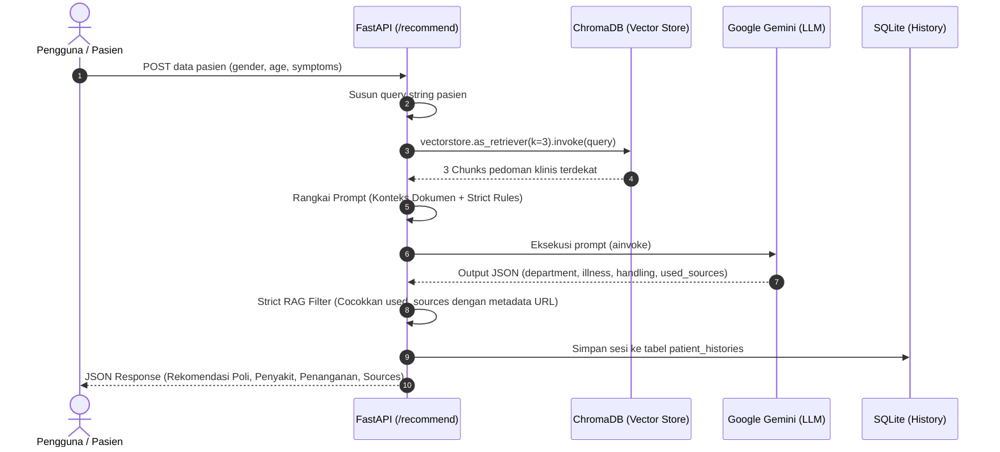

# 📚 Dokumentasi dan Mekanisme RAG (Retrieval-Augmented Generation)
**Sistem Asisten Triase Rumah Sakit (DiagnoX / HospitalAI)**

---

## 1. Pengantar & Konsep Dasar RAG

### 1.1 Apa itu RAG?
**RAG (Retrieval-Augmented Generation)** adalah teknik kecerdasan buatan (*AI*) yang menggabungkan kemampuan penelusuran dokumen (*information retrieval*) dengan kemampuan model bahasa besar (*Large Language Model / LLM*) dalam menghasilkan teks (*text generation*).

### 1.2 Analogi Sederhana: "Ujian Buka Buku"
* **LLM Tradisional (Tanpa RAG) = Ujian Tutup Buku**  
  Model hanya mengandalkan ingatan saat masa pelatihannya (*pre-training*). Jika ditanya mengenai pedoman klinis atau SOP spesifik sebuah rumah sakit, model rentan **berhalusinasi (*hallucination*)** atau mengarang jawaban yang terdengar meyakinkan namun tidak akurat secara medis.
* **LLM dengan RAG = Ujian Buka Buku (*Open-Book Exam*)**  
  Sebelum menyusun jawaban, sistem terlebih dahulu membuka "lemari arsip dokumen rumah sakit", mencari halaman atau paragraf yang relevan dengan kondisi pasien, membaca lembaran tersebut, lalu merumuskan rekomendasi berdasarkan rujukan valid tersebut.

### 1.3 Tiga Pilar RAG
| Pilar | Istilah | Fungsi dalam HospitalAI |
| :--- | :--- | :--- |
| **R** | **Retrieval** *(Pengambilan)* | Mencari potongan teks (*chunks*) dari dokumen PDF pedoman medis yang paling mirip secara semantik dengan keluhan pasien. |
| **A** | **Augmentation** *(Pengayaan)* | Menggabungkan data pasien dan potongan dokumen pedoman klinis yang relevan ke dalam sebuah *prompt* terstruktur untuk LLM. |
| **G** | **Generation** *(Penyusunan)* | LLM (Google Gemini) menganalisis data gabungan dan menyusun rekomendasi poliklinik, kemungkinan diagnosis, dan tindakan awal dalam format JSON yang terstandar. |

---

## 2. Tujuan Penerapan RAG pada Proyek

1. **Akurasi & Standar Klinis**: Menjamin rekomendasi poliklinik spesialis dan langkah triase awal berlandaskan Panduan Praktik Klinis (PPK) atau SOP resmi rumah sakit.
2. **Mitigasi Halusinasi Medis**: Membatasi ruang spekulasi LLM dengan menyodorkan konteks dokumen fakta (*ground truth*).
3. **Transparansi Sumber Rujukan (*Traceability*)**: Pasien dan tenaga medis dapat melihat dokumen rujukan (`sources`) yang menjadi dasar rekomendasi sistem.
4. **Efisiensi Token & Konteks**: Menghindari pengiriman seluruh dokumen tebal ke LLM secara berulang dengan hanya mengirimkan 3 potongan teks terpenting (*top-k chunks*).

---

## 3. Komponen & Arsitektur Teknologi

| Komponen | Teknologi | File Sumber | Keterangan |
| :--- | :--- | :--- | :--- |
| **Framework Backend** | FastAPI | `app.py` | Menyediakan endpoint REST API modular (`/api/v1`). |
| **Document Loader** | LangChain `PyPDFLoader` | `api/v1/document.py` | Mengekstrak teks dari berkas PDF dokumen panduan klinis. |
| **Text Splitter** | `RecursiveCharacterTextSplitter` | `api/v1/document.py` | Memecah teks dokumen (`chunk_size=1000`, `chunk_overlap=200`). |
| **Embedding Model** | `all-MiniLM-L6-v2` (HuggingFace) | `services.py` | Menghasilkan vektor representasi semantik secara lokal (efisien & gratis). |
| **Vector Store** | ChromaDB | `services.py`, `chroma_db/` | Menyimpan embedding dan metadata dokumen secara persisten di disk. |
| **Relational Database** | SQLite (SQLAlchemy) | `database.py` | Menyimpan metadata dokumen (`DocumentMetadata`) dan log triase (`PatientHistory`). |
| **LLM Generator** | Google Gemini (`gemini-3.5-flash-lite`) | `services.py` | LLM dengan `temperature=0.2` untuk memastikan hasil konsisten dan minim bias. |

---

## 4. Mekanisme & Alur Kerja Sistem

### 4.1 Tahap 1: Ingestion Dokumen (Penyimpanan ke Vector DB)
*File Implementasi: `api/v1/document.py`*

1. **Unggah Dokumen**: Admin mengunggah berkas PDF pedoman medis beserta nama dan URL dokumen melalui endpoint `POST /api/v1/upload-document`.
2. **Pemuatan Berkas**: Berkas disimpan sementara, kemudian teks diekstraksi halaman demi halaman menggunakan `PyPDFLoader`.
3. **Penyematan Metadata**: Tiap halaman disisipi metadata permanen:
   * `document_name`: Nama dokumen pedoman.
   * `document_url`: URL acuan (opsional).
   * `page`: Nomor halaman asli.
4. **Pemotongan Teks (*Chunking*)**: Dokumen dipecah menggunakan `RecursiveCharacterTextSplitter`:
   * Ukuran chunk: 1000 karakter.
   * Overlap chunk: 200 karakter (menjaga kesinambungan konteks antar potongan).
   * *Detail penjelasan tujuan dan fungsi overlap dapat dibaca di [PENJELASAN_CHUNKING.md](file:///run/media/helas/WD BLUE/Project/skripsi/hospitalai-be/PENJELASAN_CHUNKING.md).*
5. **Vektorisasi (*Embedding*)**: Potongan teks dikonversi menjadi vektor dimensi numerik oleh model `all-MiniLM-L6-v2`.
6. **Penyimpanan**:
   * Vektor dan potongan teks disimpan di **ChromaDB**.
   * Informasi nama dan URL disimpan di tabel SQLite **`documents`**.
   * Berkas PDF sementara dihapus dari server.



---

### 4.2 Tahap 2: Retrieval & Generation (Triase Pasien)
*File Implementasi: `api/v1/recommendations.py`*

1. **Input Pasien**: Pengguna mengirimkan jenis kelamin, usia, dan daftar gejala melalui endpoint `POST /api/v1/recommend`.
   ```json
   {
     "gender": "Perempuan",
     "age": 45,
     "symptoms": ["nyeri dada kiri", "keringat dingin", "sesak napas"]
   }
   ```
2. **Formulasi Query Semantik**:
   ```python
   query_str = f"Gejala pasien: {', '.join(patient.symptoms)}. Usia: {patient.age}. Jenis Kelamin: {patient.gender}."
   ```
3. **Pencarian Kesamaan Vektor (*Similarity Search*)**:
   ChromaDB mencari $k=3$ potongan dokumen yang memiliki jarak vektor semantik terdekat (*cosine similarity*) dengan query gejala pasien.
4. **Konstruksi Prompt (*Context Augmentation*)**:
   Potongan teks dokumen digabungkan ke dalam template instruksi medis ketat (*Strict RAG Prompt*).
5. **Evaluasi Ketat (*Strict RAG Rule*)**:
   Model Gemini 3.5 Flash Lite diwajibkan melakukan validasi relevansi:
   * **Relevan**: Jika dokumen secara spesifik membahas keluhan pasien, nama dokumen wajib dicantumkan pada field `used_sources`.
   * **Tidak Relevan**: Jika dokumen yang terambil tidak sesuai (misal pasien keluhan kejiwaan, tetapi dokumen yang terambil tentang ortopedi), field `used_sources` **wajib kosong `[]`**.
   * LLM tetap memberikan rekomendasi triase umum berdasarkan pengetahuan dasarnya.
6. **Filtering Sumber & Penyimpanan Riwayat**:
   * Sistem mencocokkan `used_sources` dengan URL asli dari metadata ChromaDB untuk menghasilkan response akhir `sources`.
   * Rekam konsultasi dicatat ke database SQLite (`patient_histories`).
   * Mengembalikan respons JSON akhir ke klien.



---

## 5. Implementasi Strict RAG

Salah satu fitur penting pada repositori ini adalah penerapan **Strict RAG Filter**. 

Pada RAG biasa, sistem sering kali secara otomatis melampirkan seluruh dokumen hasil pencarian vektor sebagai "sumber rujukan", padahal dokumen tersebut belum tentu benar-benar menjawab keluhan pasien.

### Aturan pada Prompt Sistem (`recommendations.py`):
```text
ATURAN STRICT RAG SANGAT KETAT:
1. Evaluasi secara kritis apakah isi dokumen panduan klinis di atas BENAR-BENAR relevan dan secara langsung membahas kondisi/gejala/penyakit yang dialami pasien.
2. Jika dokumen TIDAK relevan (contoh: gejala pasien berkaitan dengan psikologis/kejiwaan, luka luar/trauma, atau penyakit lain yang TIDAK dibahas secara spesifik dalam dokumen panduan klinis di atas), maka field 'used_sources' WAJIB bernilai list kosong []. JANGAN PERNAH menyertakan atau merekomendasikan dokumen yang tidak sesuai!
3. Hanya jika dokumen tersebut memang relevan dan menjadi dasar rujukan diagnosis/tindakan, cantumkan nama dokumen persis seperti di header [Dokumen: ...] ke dalam list 'used_sources'.
4. Anda tetap wajib memberikan rekomendasi poliklinik, kemungkinan penyakit, dan penanganan awal berdasarkan pengetahuan medis umum Anda meskipun dokumen referensi tidak tersedia.
```

Dengan logika ini:
* **Jika Dokumen Cocok**: Rekomendasi disertai nama dokumen pedoman dan tautannya.
* **Jika Dokumen Tidak Cocok / Belum Ada di DB**: Sistem tetap membantu pasien merekomendasikan poli umum/spesialis yang sesuai, namun secara jujur mengosongkan daftar dokumen rujukan (`"sources": []`).

---

## 6. Contoh Alur Data (Request & Response)

### Request (`POST /api/v1/recommend`)
```json
{
  "gender": "Laki-laki",
  "age": 58,
  "symptoms": ["nyeri dada menjalar ke punggung", "sesak napas mendadak", "keringat dingin"]
}
```

### Response
```json
{
  "recommended_department": [
    "Poli Jantung dan Pembuluh Darah (Kardiologi)",
    "Instalasi Gawat Darurat (IGD)"
  ],
  "possibility_of_illness": [
    "Sindrom Koroner Akut (SKA)",
    "Infark Miokard Akut",
    "Angina Pektoris Tidak Stabil"
  ],
  "initial_handling": [
    "Segera bawa ke IGD rumah sakit terdekat",
    "Posisikan pasien duduk setengah tegak untuk mengurangi sesak",
    "Batasi aktivitas fisik total dan hindari kepanikan"
  ],
  "sources": [
    {
      "document_name": "Panduan Praktik Klinis Kardiologi 2024",
      "document_url": "https://perki.or.id/pedoman-tatalaksana-ska"
    }
  ]
}
```

---

## 7. Kesimpulan

Penerapan RAG di **HospitalAI / DiagnoX** bukan sekadar pelengkap obrolan AI, melainkan **mekanisme kendali mutu medis** yang:
1. Menyelaraskan rekomendasi dengan basis data dokumen pedoman rumah sakit.
2. Menghindari kesalahan fatal atau rekomendasi ngawur (*hallucination*).
3. Memberikan transparansi kepada pihak medis mengenai dasar pertimbangan sistem.
